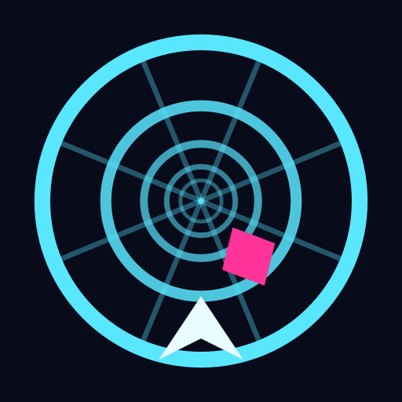
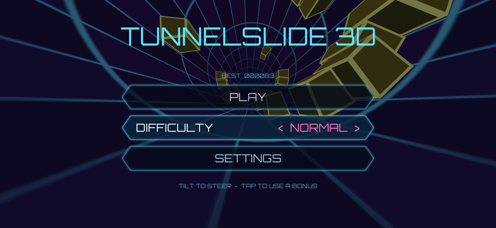
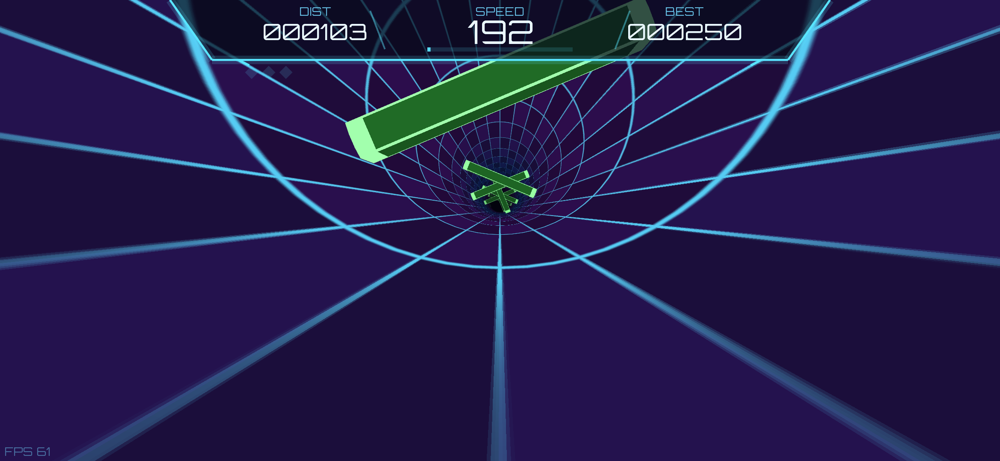
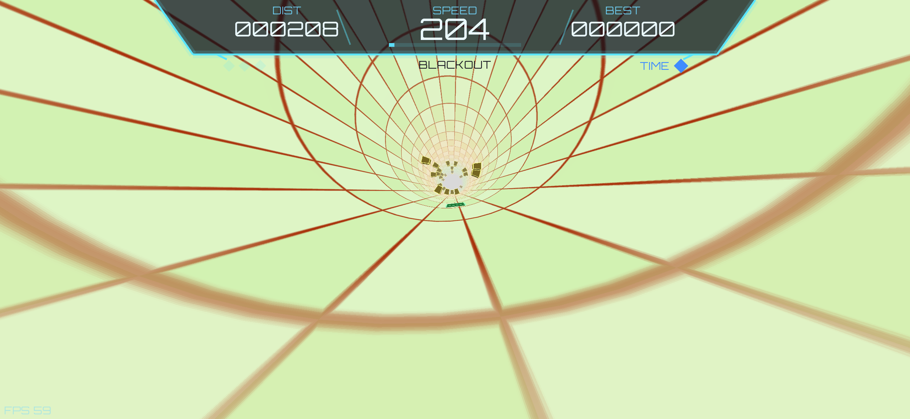

<p align="center">
  
</p>

<h1 align="center">TunnelSlide3D</h1>

<p align="center">A tunnel arcade on reflexes — an open remake of SpeedX 3D, with no ads and no trackers.</p>

<p align="center"><a href="README.md">Русский</a> · English</p>

SpeedX 3D (2010) was one of the best reflex arcades on Android, but it was abandoned long
ago, and antivirus software flags its last builds as malware because of ad SDKs.
TunnelSlide3D recreates its rules and feel from scratch: the same ever-accelerating tunnel,
the same zones and bonuses — with no ads, no network access and open source code. No code
or assets of the original were used; the rules come from public descriptions and gameplay
videos.

<p align="center">
  
  
  
</p>

> Status: 0.9.0, the first public build. Tested on one phone (Redmi Note 9, LineageOS,
> Android 17), on Linux and in Chromium (web build). Windows and macOS builds are produced
> but have not been run. The web build has no sound yet. The interface is English-only; more languages will come, but
> they are not the top priority.

## What it does

**A tunnel that changes shape.** While you ride, the tube opens into a flat plane or turns
inside out so you race on its outside. You can fall off the plane.

**Obstacles and patterns.** Scattered blocks, walls with a gap, gates, spirals, wall-to-wall
pillars, cubes rolling on a beat. The generator always leaves a way through — a bot proves it
in the tests.

**Bonuses and hazards.** Shields (up to three), quake, time dilation, space fold. Hazard
zones: blackout, dark nebula, hue shift, gravity well, plasma cloud with vortices that take
your bonuses.

**Settings.** Five difficulty levels with a separate best score each, tilt calibration,
Classic style with heavy motion blur, 3D glasses (red/cyan, green/magenta), monochrome mode.
The music is synthesised in the game, its tempo follows your speed.

## Install

| Build | Size | For |
|---|---|---|
| APK (GitHub Releases) | ~3.4 MB | Android 7.0+, OpenGL ES 2.0, landscape |
| `TunnelSlide3D-desktop-*.jar` | ~19 MB | Linux / Windows / macOS, Java 17+: `java -jar …` |
| `TunnelSlide3D-web.zip` | ~2.3 MB | any static hosting; a browser with WebGL, no sound |

The only permission is vibration. No network, storage or analytics; best scores and settings
live in the app's private preferences.

Controls: tilt the phone, tap to use a bonus, back for the menu. On a PC: arrows or A/D,
space, Esc.

---

## For developers

```
./gradlew :core:test                         # logic tests, incl. a bot driving 20 tracks
./gradlew :lwjgl3:run                        # play on a PC
./gradlew :android:installDebug              # debug build to a phone over adb
./gradlew :android:assembleRelease           # release (R8); signing via keystore.properties
./gradlew :lwjgl3:dist                       # single desktop jar
./gradlew :web:gdx_teavm_web_js_run          # web build on http://localhost:8080
./gradlew :web:gdx_teavm_web_js_release_build  # web/build/dist/js/release/webapp
java tools/IconGen.java                      # regenerate the icon
```

Needs JDK 17+ and the Android SDK (`sdk.dir` in `local.properties`). Stack: libGDX 1.14,
Kotlin, GLSL shaders, gdx-freetype; no physics engine.

Four rules hold the architecture together:
1. The world lives in 2D tunnel coordinates (u across, z along). Collisions, generation and
   the bot work only in them.
2. 3D is rendering only: `TunnelSurface` (Kotlin) and `surface.glsl` are the same
   (u, z) → 3D function and must match.
3. Speed depends on time only, so the moment the player reaches any z is known in advance
   (`Kinematics`). The passability check for moving cubes relies on it; time dilation slows
   the game clock, not the speed.
4. The player does not move: the camera stays, the world rotates and comes towards you.

Modules: `core` is the whole game (`world` — rules and generator, `render` — shaders, HUD
and menu, `audio` — synthesiser, `ui` — menu logic without graphics); `android` and `lwjgl3`
are thin launchers; `web` is the browser build via
[TeaVM](https://github.com/xpenatan/gdx-teavm), which compiles Kotlin bytecode to JavaScript,
so `core` must not use `java.util.concurrent`.

Adding an obstacle pattern: a new entry in `world/gen/Patterns.kt`. Lay the route with
`PatternBuilder.go()`, place blocks anywhere — the generator removes whatever touches the
route. Then `./gradlew :core:test` and a look:
`TS_PATTERN=<name> TS_AUTOPILOT=1 ./gradlew :lwjgl3:run`.

Working without a phone or playing by hand: `TS_*` environment variables (intent extras in
Android debug builds). `TS_AUTOPILOT=1` — the bot drives, `TS_SEED`, `TS_DIFFICULTY=0..1`,
`TS_PATTERN`, `TS_ZONE=flat|outside`, `TS_HAZARD=<zone>`, `TS_CLASSIC=1`,
`TS_STEREO=red_cyan`, `TS_SCREENSHOT=<png>` + `TS_SCREENSHOT_FRAME=<N>` — save a frame and exit.

F-Droid listing and screenshots live in `fastlane/metadata/android/`. CI (GitHub Actions)
runs the tests and builds the APK and the jar; on a `v*` tag it attaches them to the release.
APK signing in CI is enabled by the secrets `TS_KEYSTORE_B64`, `TS_KEYSTORE_PASSWORD`,
`TS_KEY_ALIAS`, `TS_KEY_PASSWORD`; without them the APK is built unsigned.

## Licence

GPL-3.0-or-later, see [LICENSE](LICENSE). Every fork must stay open, so nobody can pass off a
closed build with ads as this project.

Font: [Orbitron](https://github.com/theleagueof/orbitron), SIL Open Font License 1.1, licence
text in [assets/fonts/OFL.txt](assets/fonts/OFL.txt).
