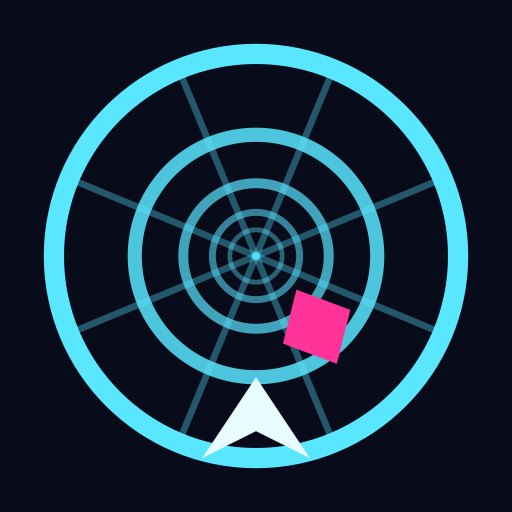
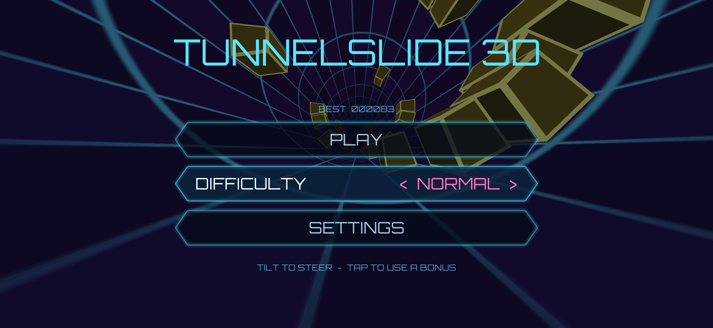
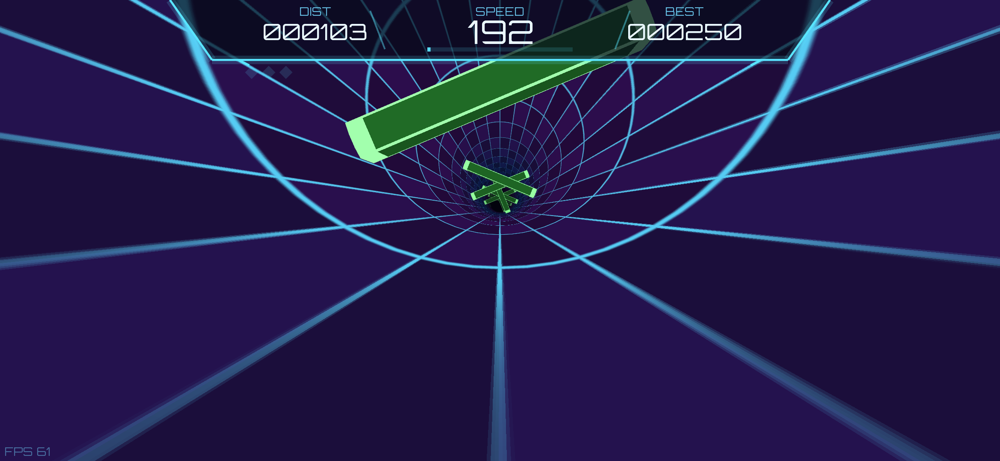
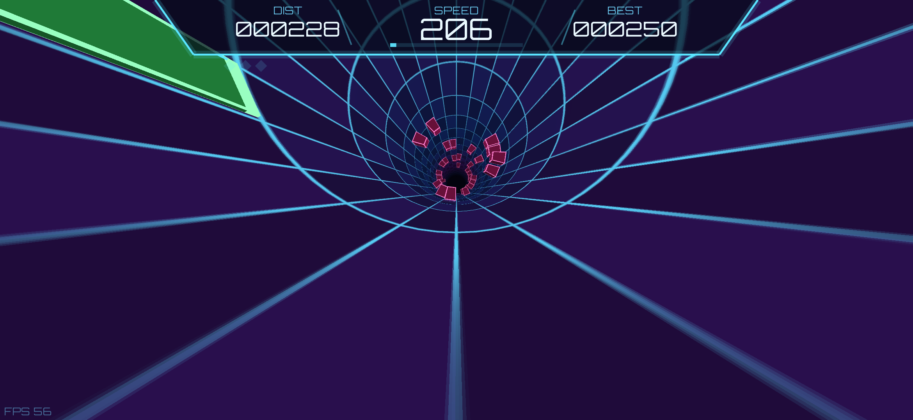
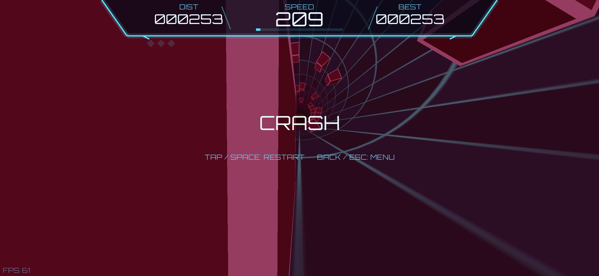
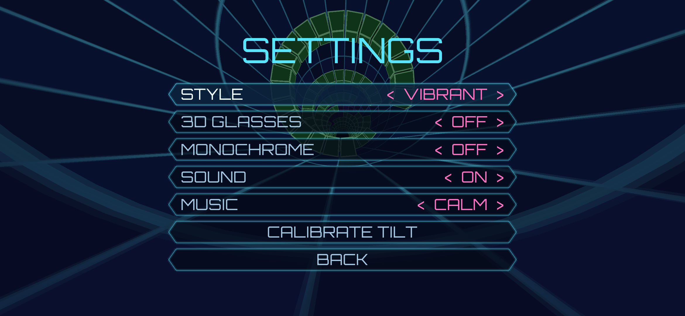

<p align="center">
  
</p>

<h1 align="center">TunnelSlide3D</h1>

<p align="center">Тоннельная аркада на реакцию — открытая рекреация SpeedX 3D, без рекламы и трекеров.</p>

<p align="center">Русский · <a href="README.en.md">English</a></p>

SpeedX 3D (2010) была одной из лучших аркад на реакцию для Android, но её давно забросили,
а последние сборки антивирусы помечают как вредоносные из-за рекламных SDK. TunnelSlide3D
повторяет её правила и ощущения заново: тот же разгоняющийся тоннель, те же зоны и бонусы,
но без рекламы, без доступа к сети и с открытым кодом. Код и ресурсы оригинала не
использовались — правила собраны из публичных описаний и видео геймплея.

> Статус: 0.9.2. Проверено на одном телефоне (Redmi Note 9,
> LineageOS, Android 17), на Linux и в Chromium (веб-версия). Сборки для Windows и macOS
> собираются, но не запускались. В веб-версии пока нет звука.

## Скриншоты

| Меню | Игра |
|---|---|
|  |  |
| **Игра** | **Счёт после крэша** |
|  |  |
| **Настройки** | |
|  | |

Снято на Redmi Note 9 (2340 × 1080).

## Что умеет

**Тоннель, который меняет форму.** Труба на ходу раскрывается в плоскость или
выворачивается наизнанку — едешь снаружи. С плоскости можно упасть.

**Препятствия и паттерны.** Россыпь блоков, стены с проходом, ворота, спирали, колонны от
стены до стены, кубы, перекатывающиеся по такту. Генератор гарантирует, что проход есть
всегда: это проверяет бот в тестах.

**Бонусы и опасные зоны.** Щиты (до трёх), quake, замедление времени, сворачивание
пространства. Зоны: blackout, тёмная туманность, «дискотека», гравитационный колодец,
плазменное облако с вихрями, отнимающими бонусы.

**Настройки.** Пять уровней сложности со своим рекордом, калибровка наклона, стиль Classic с
сильным размытием движения, 3D-очки (красный/голубой, зелёный/пурпурный), монохромный режим.
Музыка синтезируется прямо в игре: по умолчанию спокойное генеративное «пианино» с пэдами
(CALM), в настройках можно включить быстрый бит, темп которого растёт со скоростью (DRIVE).
Послушать без игры: `./gradlew :core:musicPreview` → `core/build/music-preview/*.wav`.

## Установка

| Сборка | Размер | Для кого |
|---|---|---|
| APK (GitHub Releases) | ~3,4 МБ | Android 7.0+, OpenGL ES 2.0, альбомная ориентация |
| `TunnelSlide3D-desktop-*.jar` | ~19 МБ | Linux / Windows / macOS, Java 17+: `java -jar …` |
| `TunnelSlide3D-web.zip` | ~2,3 МБ | любой статический хостинг; браузер с WebGL, без звука |

Единственное разрешение — вибрация. Сеть, хранилище и аналитика не используются; рекорды и
настройки лежат в приватных настройках приложения.

Управление: наклон телефона, тап — применить бонус, «назад» — меню. На ПК — стрелки или A/D,
пробел, Esc.

---

## Для разработчиков

```
./gradlew :core:test                         # тесты логики, включая бота, проходящего 20 трасс
./gradlew :lwjgl3:run                        # игра на ПК
./gradlew :android:installDebug              # debug-сборка на телефон через adb
./gradlew :android:assembleRelease           # release (R8); подпись — keystore.properties
./gradlew :lwjgl3:dist                       # один jar для ПК
./gradlew :web:gdx_teavm_web_js_run          # веб-версия на http://localhost:8080
./gradlew :web:gdx_teavm_web_js_release_build  # web/build/dist/js/release/webapp
java tools/IconGen.java                      # пересобрать иконку
```

Нужны JDK 17+ и Android SDK (`sdk.dir` в `local.properties`). Стек: libGDX 1.14, Kotlin,
GLSL-шейдеры, gdx-freetype; физического движка нет.

Архитектура держится на четырёх правилах:
1. Мир живёт в 2D-координатах тоннеля (u — поперёк, z — вдоль). Коллизии, генерация и бот
   работают только в них.
2. 3D — только отрисовка: `TunnelSurface` (Kotlin) и `surface.glsl` — одна и та же функция
   (u, z) → 3D, и они обязаны совпадать.
3. Скорость зависит только от времени, поэтому момент, когда игрок окажется на любом z,
   известен заранее (`Kinematics`). На этом держится проверка проходимости для движущихся
   кубов; замедление времени замедляет игровые часы, а не скорость.
4. Игрок не двигается: камера стоит, мир вращается и едет навстречу.

Модули: `core` — вся игра (`world` — правила и генератор, `render` — шейдеры, HUD и меню,
`audio` — синтезатор, `ui` — логика меню без графики); `android` и `lwjgl3` — тонкие
лаунчеры; `web` — браузер через [TeaVM](https://github.com/xpenatan/gdx-teavm), он
компилирует байткод Kotlin в JavaScript, поэтому в `core` нельзя `java.util.concurrent`.

Как добавить паттерн препятствий: новый элемент в `world/gen/Patterns.kt`. Маршрут
прокладывается через `PatternBuilder.go()`, блоки ставятся как угодно — всё, что задевает
маршрут, генератор уберёт сам. Потом `./gradlew :core:test` и просмотр:
`TS_PATTERN=<имя> TS_AUTOPILOT=1 ./gradlew :lwjgl3:run`.

Без телефона и без игры руками: переменные окружения `TS_*` (на Android — extras интента в
debug-сборке). `TS_AUTOPILOT=1` — едет бот, `TS_SEED`, `TS_DIFFICULTY=0..1`,
`TS_PATTERN`, `TS_ZONE=flat|outside`, `TS_HAZARD=<зона>`, `TS_CLASSIC=1`,
`TS_STEREO=red_cyan`, `TS_SCREENSHOT=<png>` + `TS_SCREENSHOT_FRAME=<N>` — снять кадр и выйти.

Описание для F-Droid и скриншоты — в `fastlane/metadata/android/`. CI (GitHub Actions)
гоняет тесты, собирает APK и jar; на тег `v*` прикладывает их к релизу. Подпись APK в CI
включается секретами `TS_KEYSTORE_B64`, `TS_KEYSTORE_PASSWORD`, `TS_KEY_ALIAS`,
`TS_KEY_PASSWORD`; без них APK собирается неподписанным.

## Лицензия

GPL-3.0-or-later, см. [LICENSE](LICENSE). Любой форк обязан оставаться открытым — так чужая
сборка с рекламой и закрытым кодом не сможет выдать себя за этот проект.

Шрифт [Orbitron](https://github.com/theleagueof/orbitron) — SIL Open Font License 1.1,
текст лицензии в [assets/fonts/OFL.txt](assets/fonts/OFL.txt).
